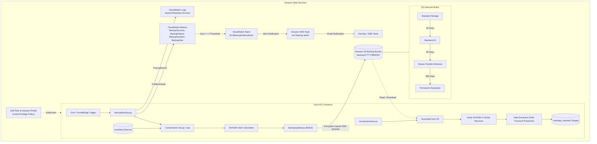
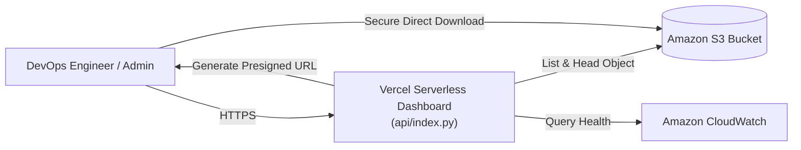

# AWS Automated Backup & Recovery System

[](LICENSE)
[](https://www.python.org/)
[](https://www.terraform.io/)
[](https://aws.amazon.com/sdk-for-python/)
[]()
[]()

A production-grade, enterprise-ready automated backup, retention, monitoring, and disaster recovery system for Linux EC2 instances backed by Amazon S3, AWS IAM, Amazon CloudWatch, and Amazon SNS.

Designed and engineered with DevOps best practices: modular Python architecture, least-privilege IAM security, Infrastructure as Code (Terraform), SHA256 integrity validation, path traversal (Zip Slip) protection, and automated CloudWatch alerting.

---

## Architecture Overview



---

## AWS Services & Rationale

| AWS Service | Role in Architecture | Why It Was Chosen |
|:---|:---|:---|
| **Amazon S3** | Object storage for backup archives | Highly durable (99.999999999% 11 9s), scalable, native server-side encryption, and lifecycle management for cost optimization. |
| **AWS IAM** | Security and access control | Provides short-lived credentials via EC2 Instance Profiles, eliminating hardcoded access keys and enforcing least-privilege boundaries. |
| **Amazon CloudWatch** | Metrics and centralized logging | Real-time observability over backup execution times, archive sizes, and failure rates; aggregates structured JSON logs. |
| **CloudWatch Alarms** | Anomaly detection | Automatically triggers alerts whenever backup failures are detected or scheduled backup runs miss execution windows. |
| **Amazon SNS** | Incident notification | Dispatches real-time email alerts to administrators and DevOps on backup failure. |
| **Amazon EventBridge** | Cloud-native scheduling | Supports enterprise-grade cron schedules triggering backup jobs without relying solely on local daemon crontabs. |
| **Terraform** | Infrastructure as Code (IaC) | Declarative, reproducible, version-controlled provisioning of all AWS resources with complete dependency tracking. |

---

## Project Structure

```text
aws-backup-recovery/
├── backup/
│   ├── __init__.py
│   ├── backup.py              # Main backup orchestration CLI
│   ├── compression.py         # Archive creation (tar.gz/zip) & SHA256 calculation
│   └── upload.py              # Boto3 S3 upload with SSE-S3 & duplicate check
├── recovery/
│   ├── __init__.py
│   └── restore.py             # Disaster recovery CLI (list, download, verify, extract)
├── monitoring/
│   ├── __init__.py
│   └── cloudwatch.py          # Custom metrics, CloudWatch log streams & SNS notifications
├── config/
│   ├── __init__.py
│   └── settings.py            # Typed dataclass config & structured JSON logger
├── scripts/
│   ├── install_dependencies.sh# Auto-installs Python, pip, AWS CLI on Linux EC2
│   └── setup.sh               # Environment initializer & Linux crontab configurator
├── iam/
│   ├── backup-policy.json     # Least-privilege IAM policy document
│   └── ec2-trust-policy.json  # EC2 assume-role trust relationship
├── infrastructure/
│   └── terraform/
│       ├── versions.tf        # Provider requirements & version pins
│       ├── variables.tf       # Customizable deployment parameters
│       ├── main.tf            # S3, IAM, CloudWatch, SNS, EventBridge resources
│       ├── outputs.tf          # Exported resource ARNs and bucket IDs
│       └── terraform.tfvars.example
├── tests/
│   ├── __init__.py
│   ├── test_backup.py         # 18 unit tests for backup, S3, and CloudWatch
│   └── test_recovery.py       # 10 unit tests for recovery, checksums, and Zip Slip
├── logs/                      # Local structured log directory (.gitkeep)
├── requirements.txt           # Python dependencies
├── .env.example               # Environment variables template
├── .gitignore                 # Excludes secrets, caches, and state files
└── README.md                  # Comprehensive technical documentation
```

---

## Prerequisites

- **Python 3.9+** and `pip`
- **AWS CLI v2** installed and configured (`aws configure`)
- **Terraform 1.5+** (optional, for deploying AWS infrastructure)
- Linux environment (Amazon Linux 2023, Amazon Linux 2, Ubuntu 20.04+, or Debian)

---

## Local Development & Testing

This project is built to allow complete local verification without requiring paid AWS resources or active credentials. All AWS SDK calls are stubbed and mocked.

### 1. Clone & Set Up Virtual Environment

```bash
git clone https://github.com/your-username/aws-backup-recovery.git
cd aws-backup-recovery

# Create and activate virtual environment
python3 -m venv venv
source venv/bin/activate  # On Windows: .\venv\Scripts\activate

# Install requirements
pip install -r requirements.txt
```

### 2. Configure Local Environment Variables

```bash
cp .env.example .env
```

Edit `.env` to configure your directories and test bucket:

```ini
AWS_REGION=us-east-1
S3_BUCKET_NAME=my-company-ec2-backups
S3_BACKUP_PREFIX=backups
BACKUP_SOURCE_DIR=/var/data
BACKUP_FORMAT=tar.gz
RESTORE_DIR=/var/data_restored
ENABLE_CLOUDWATCH_METRICS=true
ENABLE_CLOUDWATCH_LOGS=true
CLOUDWATCH_NAMESPACE=AWSBackupRecovery/EC2
CLOUDWATCH_LOG_GROUP=/aws/ec2/backup-recovery
LOG_LEVEL=INFO
```

### 3. Run the Automated Test Suite

Execute the unit and integration tests with `pytest`:

```bash
pytest -v
```

All 28 tests will pass locally:
- File discovery and exclusion of transient files (`*.tmp`, `*.swp`)
- Compression into `tar.gz` and `zip` with SHA256 checksum generation
- Duplicate upload detection (skipping redundant uploads)
- CloudWatch metrics publishing and structured log streaming
- Disaster recovery listing, download, and SHA256 verification
- Collision prevention (aborting unless `--force` is passed)
- Directory traversal / Zip Slip security prevention

---

## AWS Deployment (Infrastructure as Code)

Provision all AWS infrastructure with Terraform in minutes.

### Step 1: Navigate to Terraform Directory

```bash
cd infrastructure/terraform
```

### Step 2: Configure Deployment Variables

```bash
cp terraform.tfvars.example terraform.tfvars
```

Update `terraform.tfvars`:
```hcl
aws_region                    = "us-east-1"
environment                   = "prod"
bucket_prefix                 = "my-company-ec2-backup"
retention_days_standard_ia    = 30
retention_days_glacier        = 90
retention_days_expiration     = 365
cloudwatch_log_retention_days = 30
alert_email                   = "devops-alerts@yourcompany.com"
backup_schedule_expression    = "cron(0 2 * * ? *)"
```

### Step 3: Initialize, Plan, and Apply

```bash
# Initialize Terraform and download AWS provider
terraform init

# Validate configuration
terraform validate

# Review proposed changes
terraform plan

# Provision resources
terraform apply -auto-approve
```

### Step 4: Note Terraform Outputs

Upon completion, Terraform will output:
- `s3_bucket_name`: The globally unique S3 bucket created for backups.
- `iam_instance_profile_name`: The IAM Instance Profile to attach to your EC2 instance.
- `sns_topic_arn`: The SNS topic for backup alerts.
- `cloudwatch_log_group_name`: Centralized log group name.

Confirm your SNS subscription by clicking the confirmation link sent to `alert_email`.

---

## EC2 Setup & IAM Configuration

### Step 1: Attach IAM Instance Profile to EC2

1. Open the **AWS EC2 Console**.
2. Select your EC2 instance.
3. Click **Actions** > **Security** > **Modify IAM role**.
4. Select the IAM Instance Profile created by Terraform (e.g. `ec2-backup-instance-profile-prod`) and click **Update IAM role**.

*Note: No AWS access keys or secrets are stored on the EC2 instance.*

### Step 2: Deploy Project to EC2

SSH into your EC2 instance:

```bash
ssh -i my-key.pem ec2-user@<ec2-ip-address>

# Clone repository
git clone https://github.com/your-username/aws-backup-recovery.git
cd aws-backup-recovery

# Run dependency installer
chmod +x scripts/install_dependencies.sh scripts/setup.sh
./scripts/install_dependencies.sh

# Run environment setup
./scripts/setup.sh
```

Update `.env` on the instance with the Terraform-generated S3 bucket name:
```bash
sed -i 's/your-backup-bucket-name-here/<s3_bucket_name_from_terraform>/g' .env
```

---

## Vercel Deployment (Web Dashboard & Management API)

The project includes a serverless web management console (`api/index.py` & `vercel.json`) that can be deployed to **Vercel** with one click or via the Vercel CLI.

### Architectural Separation
- **Host / EC2 Instance**: Runs the automated backup agent (`backup/backup.py`) where your actual application data and persistent files live.
- **Vercel Serverless Console**: Connects securely to AWS to monitor backups, view CloudWatch health metrics, and generate **S3 Presigned URLs** for secure direct archive downloads from any browser.



### Option 1: Deploy via Vercel Git Integration (Recommended)
1. Push your repository to **GitHub**:
   ```bash
   git push origin main
   ```
2. In the [Vercel Dashboard](https://vercel.com/new), click **Import Project** and select your GitHub repository.
3. In **Environment Variables**, add the following:
   - `S3_BUCKET_NAME`: Name of your S3 backup bucket (from Terraform output)
   - `S3_BACKUP_PREFIX`: `backups`
   - `AWS_REGION`: `us-east-1` (or your chosen region)
   - `AWS_ACCESS_KEY_ID`: Dedicated read-only IAM access key (see IAM policy below)
   - `AWS_SECRET_ACCESS_KEY`: Dedicated read-only IAM secret key
4. Click **Deploy**. Vercel will automatically build the `@vercel/python` serverless function.

### Option 2: Deploy via Vercel CLI
```bash
# Install Vercel CLI globally (if not already installed)
npm install -g vercel

# Deploy project to Vercel
vercel

# Add environment variables
vercel env add S3_BUCKET_NAME
vercel env add AWS_REGION
vercel env add AWS_ACCESS_KEY_ID
vercel env add AWS_SECRET_ACCESS_KEY

# Deploy to production
vercel --prod
```

### Least-Privilege IAM Policy for Vercel Web Console
Create a dedicated IAM user for Vercel with this minimal read-only policy:
```json
{
  "Version": "2012-10-17",
  "Statement": [
    {
      "Sid": "AllowS3BackupListingAndDownload",
      "Effect": "Allow",
      "Action": [
        "s3:ListBucket",
        "s3:GetObject"
      ],
      "Resource": [
        "arn:aws:s3:::your-backup-bucket-name",
        "arn:aws:s3:::your-backup-bucket-name/*"
      ]
    },
    {
      "Sid": "AllowCloudWatchHealthQuery",
      "Effect": "Allow",
      "Action": [
        "cloudwatch:GetMetricData",
        "cloudwatch:ListMetrics"
      ],
      "Resource": "*"
    }
  ]
}
```

---

## Backup Execution Guide

### 1. Manual Backup Run

Run a backup using default settings from `.env`:
```bash
python backup/backup.py
```

### 2. Backup CLI Options

| Argument | Short | Description |
|:---|:---|:---|
| `--source <DIR>` | `-s` | Directory to back up (overrides `BACKUP_SOURCE_DIR`). |
| `--bucket <NAME>` | `-b` | S3 bucket name (overrides `S3_BUCKET_NAME`). |
| `--prefix <PREFIX>` | `-p` | S3 prefix (overrides `S3_BACKUP_PREFIX`). |
| `--format <FORMAT>` | `-f` | Compression format: `tar.gz` (default) or `zip`. |
| `--staging-dir <DIR>`| | Directory for local archive creation before upload. |
| `--keep-local` | | Retain local archive copy after upload to S3. |
| `--force` | | Force upload even if identical hash exists in S3. |

**Example: Back up custom directory with zip compression:**
```bash
python backup/backup.py --source /opt/myapp/data --format zip --keep-local
```

### 3. Backup Scheduling

#### Option A: Automated Linux Cron Setup

Install a daily cron job running at 02:00 AM:
```bash
./scripts/setup.sh --cron daily
```

Install a weekly cron job running every Sunday at 02:00 AM:
```bash
./scripts/setup.sh --cron weekly
```

View active crontab:
```bash
crontab -l
```

#### Option B: AWS EventBridge Scheduling

The Terraform configuration includes an EventBridge scheduled rule:
```text
cron(0 2 * * ? *)
```
This rule triggers daily at 02:00 UTC and can be connected to AWS Systems Manager (SSM) Run Command to initiate the backup script remotely across an entire fleet of EC2 instances.

---

## Disaster Recovery & Restore Guide

The recovery system allows administrators to inspect available backups, verify cryptographic integrity, and safely extract archives.

### 1. List Available Backups in S3

```bash
python recovery/restore.py --list
```

**Output:**
```text
==========================================================================================
#   | Date (UTC)           | Size       | S3 Key
------------------------------------------------------------------------------------------
1   | 2026-11-17 05:00:00  | 42.15 MB   | backups/2026/11/17/backup_2026-11-17_050000.tar.gz
2   | 2026-11-16 02:00:00  | 41.80 MB   | backups/2026/11/16/backup_2026-11-16_020000.tar.gz
3   | 2026-11-15 02:00:00  | 40.25 MB   | backups/2026/11/15/backup_2026-11-15_020000.tar.gz
==========================================================================================
```

### 2. Interactive Restore

Run without arguments to launch interactive selection:
```bash
python recovery/restore.py
```
Prompt:
```text
Enter the number of the backup to restore (or 'q' to quit): 1
```

### 3. Automated Restore (Latest Backup)

To automatically restore the most recent backup into a specific target directory:
```bash
python recovery/restore.py --latest --target-dir /var/data_restored
```

### 4. Restore Specific Backup by S3 Key

```bash
python recovery/restore.py \
  --key backups/2026/11/17/backup_2026-11-17_050000.tar.gz \
  --target-dir /tmp/recovered_files
```

### 5. Overwrite Protection Guarantee

To prevent catastrophic accidental data loss, the restore engine inspects all files inside the archive before extraction:
- If any file already exists in the target directory, extraction is **immediately aborted**:
  ```text
  [ERROR] Extraction aborted! Found 3 existing files in target directory '/var/data'.
  Refusing to overwrite existing files without --force flag.
  ```
- To deliberately overwrite existing files, supply the `--force` flag:
  ```bash
  python recovery/restore.py --latest --target-dir /var/data --force
  ```

---

## Backup Retention & Lifecycle Management

Backups are transitioned automatically using Amazon S3 Lifecycle configurations to optimize storage costs:

1. **Days 1 - 30**: Stored in **S3 Standard** for immediate, low-latency recovery.
2. **Day 31**: Automatically transitioned to **S3 Standard-IA (Infrequent Access)** (up to 50% storage cost savings).
3. **Day 91**: Automatically transitioned to **S3 Glacier Flexible Retrieval** (up to 80% storage cost savings).
4. **Day 366**: Permanently expired and deleted.

### How to Restore Backups from S3 Glacier

If an archive has transitioned to S3 Glacier, initiate retrieval prior to restoring:

```bash
# Initiate Expedited (1-5 min) or Standard (3-5 hours) restore tier
aws s3api restore-object \
  --bucket <S3_BUCKET_NAME> \
  --key backups/2026/08/01/backup_2026-08-01_020000.tar.gz \
  --restore-request '{"Days":7,"GlacierJobParameters":{"Tier":"Standard"}}'
```

Once the restore status indicates available (`OngoingRestore: false`), execute the normal `recovery/restore.py` command.

---

## Monitoring, Metrics & Alerting

### 1. CloudWatch Custom Metrics

All backup operations publish metrics to CloudWatch under namespace `AWSBackupRecovery/EC2`:

- `BackupSuccess`: `1` on successful completion, `0` on failure.
- `BackupFailure`: `1` on failure, `0` on success.
- `BackupDurationSeconds`: Total backup process duration in seconds.
- `BackupSizeBytes`: Compressed size of the uploaded archive in bytes.
- `BackupFileCount`: Total number of individual files contained in the backup.

### 2. CloudWatch Alarms

The Terraform configuration deploys `EC2BackupFailureAlarm`:
- **Metric**: `BackupFailure` (Sum >= 1 over 5 minutes)
- **Action**: Triggers notification to the Amazon SNS topic.

### 3. Structured Logging

Every backup operation writes structured JSON logs locally to `logs/backup.log` and pushes events to CloudWatch Logs (`/aws/ec2/backup-recovery`):

```json
{
  "status": "SUCCESS",
  "timestamp": "2026-11-17T05:00:15.123456Z",
  "source_dir": "/var/data",
  "s3_uri": "s3://my-company-ec2-backup-prod-a1b2c3d4/backups/2026/11/17/backup_2026-11-17_050000.tar.gz",
  "file_count": 142,
  "uncompressed_bytes": 104857600,
  "compressed_bytes": 44192000,
  "sha256": "4a7b5d...e2f1",
  "duration_seconds": 12.45,
  "is_duplicate": false
}
```

---

## Security Engineering

This system implements enterprise cloud security standards:

1. **No Hardcoded Credentials**:
   - Zero access keys (`AKIA...`) or secret keys are stored in code or on EC2 disk.
   - Authentication relies exclusively on **EC2 Instance Profiles** assuming an IAM role via AWS STS.
2. **Least-Privilege IAM Policy**:
   - Explicitly limits actions to `s3:PutObject`, `s3:GetObject`, `s3:ListBucket`, `cloudwatch:PutMetricData`, and `logs:PutLogEvents`.
   - Restricts S3 actions specifically to the backup bucket ARN.
3. **S3 Block Public Access**:
   - All 4 S3 Block Public Access settings are enabled (`block_public_acls`, `block_public_policy`, `ignore_public_acls`, `restrict_public_buckets`).
4. **Server-Side Encryption**:
   - All S3 uploads mandate `ServerSideEncryption: AES256`.
5. **Path Traversal (Zip Slip) Protection**:
   - Archive extraction validates that resolved output paths cannot traverse outside the target directory boundary.
6. **Collision Protection**:
   - Prevents accidental overwriting of operational data during recovery drills.

---

## Clean-Up Instructions (Tear-down)

To avoid incurring ongoing AWS charges when you are finished using the project:

```bash
# 1. Empty the S3 bucket (Terraform cannot delete non-empty buckets by default)
aws s3 rm s3://<s3_bucket_name_from_terraform> --recursive

# 2. Destroy all infrastructure via Terraform
cd infrastructure/terraform
terraform destroy -auto-approve

# 3. Clean up local cron job on EC2 (if installed)
crontab -l | grep -v "AWS-AUTOMATED-BACKUP" | crontab -
```

---

## Contributing & License

Contributions, issues, and feature requests are welcome.
Distributed under the MIT License. See `LICENSE` for more information.
